

  <ul align="center">
    

      <h1>Hey, I'm Ali&nbsp;</h1>
       
      <strong>A little curiosity. A lot of Python.</strong>
    

  </ul>

## About Me

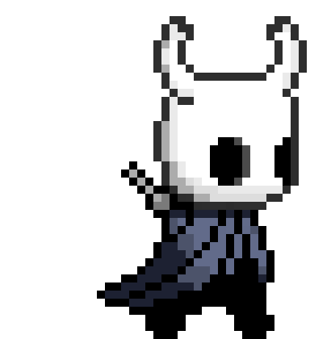

I'm an AI undergrad and an **Associate Microsoft Student Ambassador** who enjoys turning ideas into working projects.

I build **Intelligent Agentic and RAG systems**, with a focus on retrieval quality, evaluation, and reliable Python backends.

## Featured Projects

### [Discord Documentation Copilot](https://github.com/alihassanwarsi/discord-documentation-copilot)

A RAG assistant for Discord documentation with **hybrid retrieval, reranking, and citation checks**. Includes semantic verification, confidence scoring, and refusal handling when the retrieved evidence is insufficient.

`Python` `LangChain` `Chroma` `FastAPI` `RAGAS`

### [Permissioned Agent Sandbox](https://github.com/alihassanwarsi/permissioned-agent-sandbox)

A tool-using AI agent that demonstrates **role-based permissions, risk checks, and human approval**. Includes input validation, per-user rate limits, and OpenTelemetry tracing.

`Python` `LangGraph` `FastAPI` `OpenTelemetry` `Docker`

### [FlyRank Social Studio](https://github.com/alihassanwarsi/flyrank-capstone-social-studio)

Built during my **FlyRank AI internship**: a backend for Gemini-generated social posts, human review, and durable scheduling. Supports real Discord publishing and mock X and LinkedIn adapters.

`Python` `FastAPI` `Gemini API` `PostgreSQL` `Docker Compose`

## Tech Stack

**AI & Retrieval**

  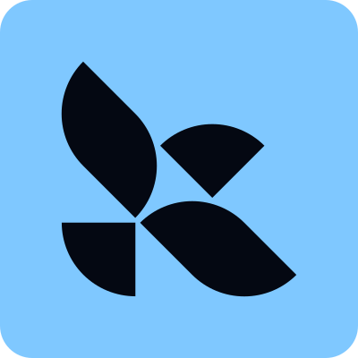
  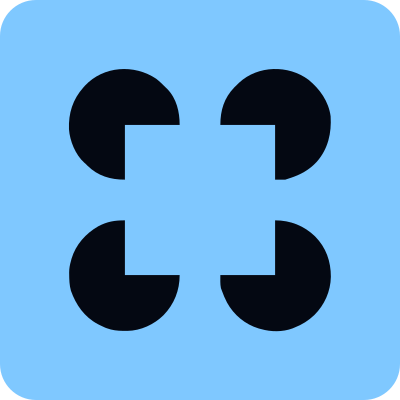
  
  
  
  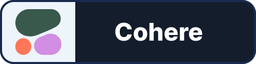
  
  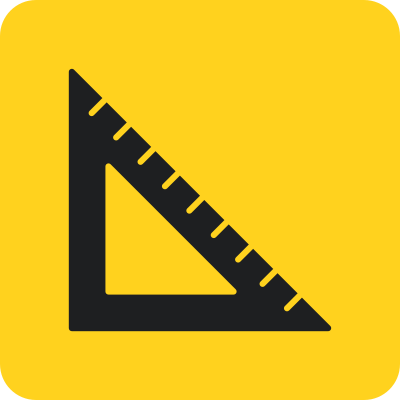

**Backend & Apps**

  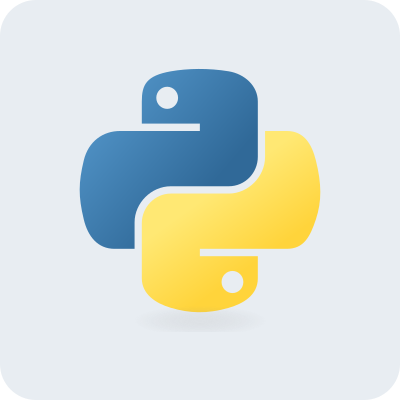
  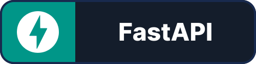
  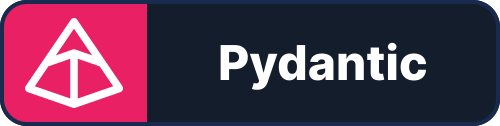
  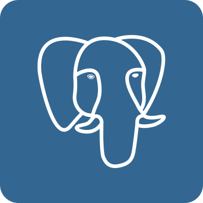
  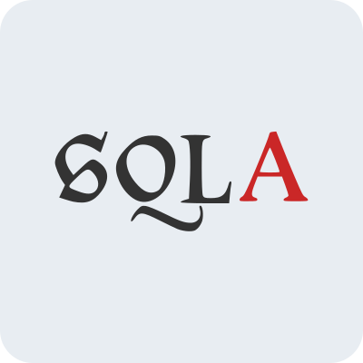
  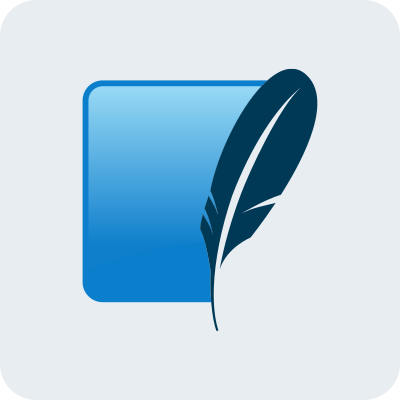
  
  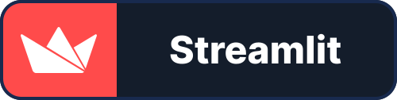

**ML & Data**

  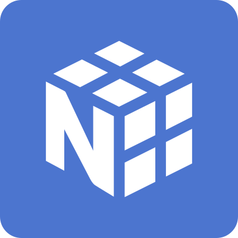
  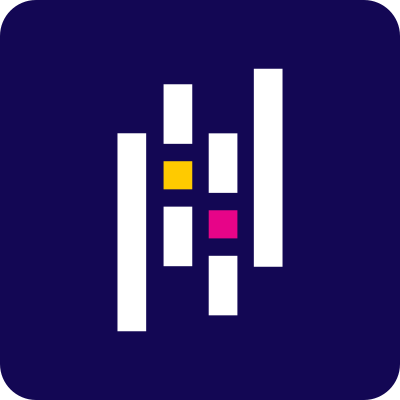
  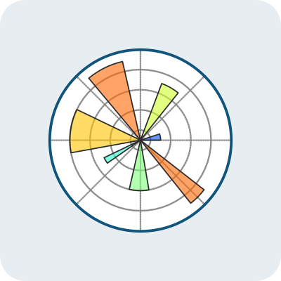
  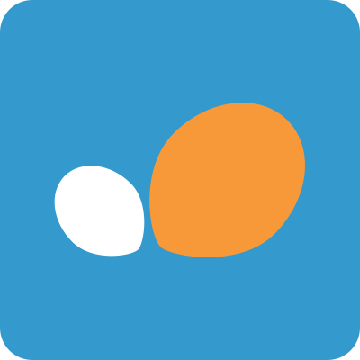
  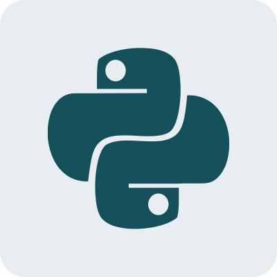
  

**DevOps & Tools**

  
  
  
  
  
  
  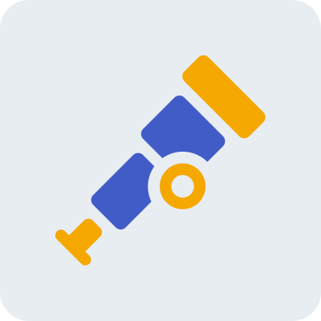

## Beyond the Code

As part of the Microsoft Student Ambassadors program, I enjoy hosting tech sessions, sharing what I learn, and helping fellow students explore AI.

When I'm not building AI systems or debugging something that should've worked 20 minutes ago, you'll probably find me gaming, exploring new stuff or chilling with music.

  
## Contact Me

Want to talk AI, build something, or just say hi?

  &nbsp;
  &nbsp;
  &nbsp;

Thanks for stopping by. Have a great day!

  

